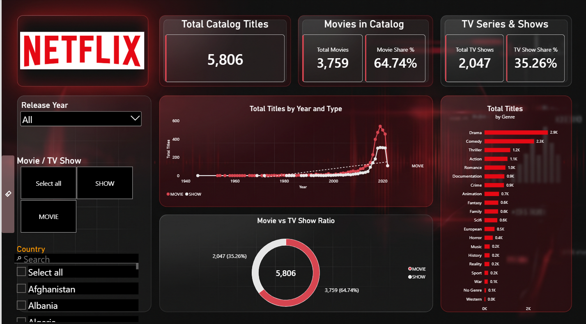
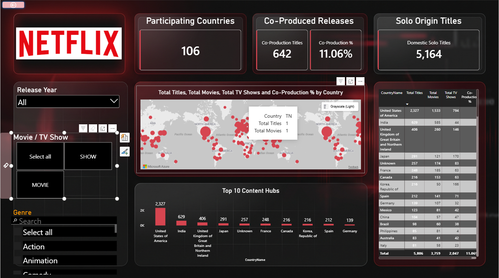
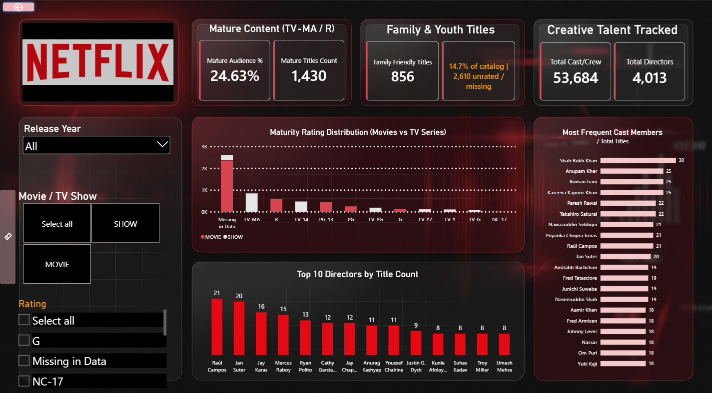

# Netflix Content Analysis — Power BI Dashboard

A multi-page Power BI report that analyses the Netflix catalogue: how many movies and TV shows it holds, how the catalogue has grown, which genres and maturity ratings dominate, and who the most frequent cast and directors are. It answers the question a content analyst asks: *what does the catalogue actually look like, and where is it concentrated?*




---

## Headline numbers

| KPI | Value |
|---|---|
| Total catalogue titles | **5,806** |
| Movies | **3,759 (64.7%)** |
| TV shows | **2,047 (35.3%)** |
| Co-produced titles (more than one country) | **642 (11.1%)** |
| Mature titles (TV-MA, R, NC-17) | **1,430 (24.6% of all titles)** |
| Release years covered | **1945 – 2022** |

## Key insights

- **Movies make up almost two thirds of the catalogue** (64.7%), with TV shows at 35.3%.
- **The catalogue is dominated by recent releases.** Titles per release year rise from 236 in 2015 to a peak of 848 in 2019, then stay above 750 until 2021. 2022 is a partial year.
- **Drama (2,901 titles) and Comedy (2,269) lead the genre mix**, followed by Thriller (1,178), Action (1,053), Romance (958) and Documentation (910).
- **A quarter of the catalogue is mature content** (TV-MA, R or NC-17), and TV-MA is the most common rating among those that are recorded.
- **Age certification is missing for 2,610 titles (45%)**, which is the largest data-quality gap in the dataset and shows up as the "Missing in Data" bar.
- **The United States is the biggest source of titles** with 2,327 (40% of the catalogue), followed by India (629), the United Kingdom (406), Japan (291) and France (248). India is the main outlier: 585 of its 629 titles are movies.
- **Only 11% of titles are co-productions**, so most of the catalogue comes from a single production country.
- **Indian actors dominate the most-frequent-cast list.** Seven of the top ten are Indian performers, led by Shah Rukh Khan with 30 titles, ahead of Anupam Kher, Boman Irani and Kareena Kapoor Khan (25 each).
- **No single director dominates.** The most prolific are Raúl Campos (21 titles) and Jan Suter (20), and the top ten are all within 8 to 21 titles.

## Report pages

| Page | What it shows |
|---|---|
| **Overview** | Catalogue, movie and TV show KPIs, titles by release year and type with a trend line, movie vs TV show ratio and titles by genre |
| **Geography** | Production-country and co-production view: a world map, a Top 10 Content Hubs chart and a country table with titles, movies, TV shows and co-production share |
| **Talent and Ratings** | Mature and family-friendly counts, maturity rating distribution (movies vs TV series), top 10 directors and most frequent cast members |

## Dashboard features

- **Release Year, Movie / TV Show, Country, Genre and Rating slicers** on the report pages, with a side panel that can be opened and closed
- **KPI cards** with a custom Netflix-style dark and red theme
- **Line chart with trend line** of titles by release year, split by type
- **Donut chart** of the movie vs TV show ratio
- **Maturity rating distribution** comparing movies and TV series
- **Top 10 directors and most frequent cast** bar charts built from the credits table
- Custom background image and consistent cards across all pages

## What I did

1. **Prepared the data (Power Query):** loaded the Titles and Credits tables and cleaned genres, production countries and age certifications so each can be analysed on its own.
2. **Modelled the data:** linked Titles to Credits and used bridge tables (`TitleGenreBridge`, `TitleCountryBridge`) for the many-to-many links between titles, genres and countries, with the cross-filter direction set so a country or genre selection correctly filters title counts.
3. **Wrote DAX measures** for total titles, movie and TV show counts and shares, co-production %, mature content %, and cast and director counts.
4. **Designed the report** with a shared slicer panel, a custom background and a consistent theme across pages.
5. **Added drill-down visuals** for genres, maturity ratings, directors and cast.

## Dataset

[`data/Netflix-Data.xlsx`](data/Netflix-Data.xlsx) is a public dataset of Netflix titles and credits (releases up to 2022). It contains no personal or confidential information.

| Sheet | Rows | Key columns |
|---|---|---|
| **Titles** | 5,806 | title, type (Movie / Show), release year, age certification, runtime, genres, production countries, seasons, IMDb and TMDB scores |
| **Credits** | 77,213 | person, title, name, character, role (Actor / Director) |

This project is for learning and portfolio purposes only and is not affiliated with Netflix.

## Repository structure

```
├── report/
│   └── Netflix-Content-Analysis.pbix  # Dashboard
├── data/
│   └── Netflix-Data.xlsx              # Titles and Credits
├── assets/                            # Background image used in the report
└── images/                            # Dashboard screenshots
```

## More screenshots




## How to open

1. Install [Power BI Desktop](https://www.microsoft.com/power-platform/products/power-bi/desktop) (free).
2. Download `report/Netflix-Content-Analysis.pbix` and open it.
3. If you are asked for the data source, point it to `data/Netflix-Data.xlsx` and refresh.

---

Built by **Bukhtawar Ali** as part of the *AI-Powered Analytics with Power BI* course (EduHubSpot), 2026.
[LinkedIn](https://www.linkedin.com/in/bukhtawar-ali-4441291a9) · [Portfolio](https://bukhtawarali110.github.io) · [GitHub](https://github.com/BukhtawarAli110)
